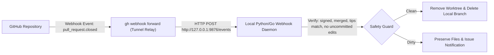

# Local Webhook & Event-Driven Development Automation

This skill defines the architectural pattern and operational procedures for receiving GitHub webhook events locally in real-time, executing automated filesystem and branch cleanups upon PR merge, and ensuring cold-boot reconciliation after offline periods.

---

## 1. Overview & Architectural Design

Traditional local environment maintenance relies on manual cleanup commands or periodic polling. Polling incurs API latency and exhausts GitHub API rate limits.

This skill establishes a **Push-Based Event Architecture**:



---

## 2. Core Invariants & Safety Guarantees

> [!IMPORTANT]
> **DIRTY STATE PRESERVATION**: The webhook daemon must NEVER delete any worktree directory or branch if `git status --porcelain` returns uncommitted files, even if the PR was merged remotely.

> [!IMPORTANT]
> **SIGNED EVENTS ONLY**: the daemon listens on 127.0.0.1, which every web page the user opens can also POST to. It refuses any request with an `Origin` or `Sec-Fetch-*` header (a browser), a `Host` that is not `127.0.0.1`, `localhost` or `[::1]` with its port (DNS rebinding), a `Content-Type` other than `application/json`, or an `X-Hub-Signature-256` that is not the HMAC-SHA256 of the body with the secret in `~/.config/git-webhook-daemon/secret` (made on first start, mode 0600). Every check but the signature runs before the body is read, so a refused browser request never makes the daemon buffer its body. `GET /health` returns only a count, never repository paths.

> [!IMPORTANT]
> **MERGED AND UNCHANGED ONLY**: the payload alone never deletes anything. A branch is cleaned only after `gh pr view` reports the PR as `MERGED` from a branch of the same repository, and only while the local branch tip is the merged head commit or an ancestor of it. The remote branch is deleted only while it still points at that commit (`--force-with-lease`) and no open PR targets it. PRs closed without merging, `main`, `master`, `develop`, the remote's default branch, `Frozen-*` and `*Do-Not-Touch*` are never touched.

> [!TIP]
> **COLD-BOOT RECONCILIATION**: If PRs are merged from a mobile device or secondary machine while the primary workstation is offline or powered off, the daemon must run an initial reconciliation sweep immediately upon boot before entering live listening mode. `--reconcile-all` sweeps every registered repository, `--reconcile-repo` only `--repo-dir` (or the current checkout); with `--dry-run` neither deletes anything nor runs `git fetch --prune`, so remote-tracking refs stay as they are.

---

## 3. Operational Runbook

### A. Starting the Webhook Relay
The GitHub CLI provides built-in webhook forwarding without requiring public DNS or tunneling tools (like ngrok). `skills-sync daemon forward <owner>/<repo>` runs it with the daemon's secret; by hand:
```bash
secret_file="$(git-webhook-daemon --init-secret)"   # prints the path, creates the secret if missing
gh webhook forward \
  --repo=<owner>/<repo> \
  --events=pull_request \
  --url=http://127.0.0.1:9876/events \
  --secret "$(cat "$secret_file")"
```
A forwarder started without `--secret` gets `401` for every event, so nothing is cleaned until it is restarted with it. `gh webhook forward` takes the secret only as an argument (no file or environment option), so while the forwarder runs any local user can read it with `ps` or in `/proc/<pid>/cmdline`. On a shared machine, anyone who reads it can sign events that make the daemon clean up a merged PR's branches; the daemon still asks GitHub that the PR was merged before it deletes anything.

### B. Daemon Event Handling Logic
When receiving a request (`scripts/git-webhook-daemon.py`):
```python
# 1. refuse_reason(): browser headers, Host, Content-Type, X-Hub-Signature-256
# 2. X-GitHub-Event must be pull_request (ping answers pong)
# 3. action == "closed" and pull_request.merged is True, else ignore
# 4. verify_merged_pr(): gh pr view <n> --repo <slug> -> state MERGED, same head
#    branch, not from a fork; take its headRefOid
# 5. clean_worktree_and_branch(repo, branch, headRefOid):
#    protected? local tip not merged? dirty worktree? -> keep everything
#    else git worktree remove, git branch -D (safe: every commit was merged),
#    and git push --delete with --force-with-lease=<branch>:<headRefOid>
#    unless an open PR targets the branch
```

### C. Systemd User Service Configuration
To run the event daemon automatically on user login:
```ini
# ~/.config/systemd/user/git-webhook-daemon.service
[Unit]
Description=Local Git Webhook Event Daemon
After=network.target

[Service]
Type=simple
ExecStart=/usr/bin/python3 %h/.local/bin/git-webhook-daemon
Restart=always
RestartSec=5

[Install]
WantedBy=default.target
```

`scripts/setup-service.sh` (`skills-sync daemon setup`) installs the daemon, creates the secret and enables and restarts the service, so a new copy replaces a running one. By hand:
```bash
systemctl --user daemon-reload
systemctl --user enable git-webhook-daemon.service
systemctl --user restart git-webhook-daemon.service
```

---

## 4. Cold-Boot Offline Catch-Up Algorithm

Whenever the daemon initializes:
```bash
# 1. Inspect all active worktrees
git worktree list --porcelain

# 2. Query GitHub for merged PR branches and the branches open PRs use
gh pr list --state merged --limit 50 --json headRefName,headRefOid,isCrossRepository
gh pr list --state open --limit 200 --json headRefName

# 3. For each local branch named by a merged PR (not from a fork) that no open
#    PR uses again: the same checks as a webhook event, with that PR's headRefOid
```
